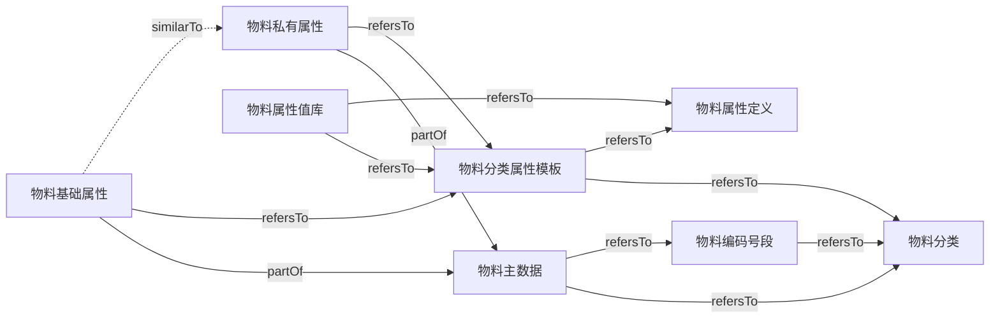
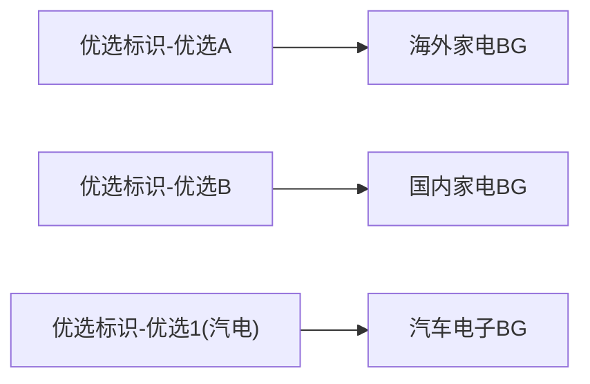
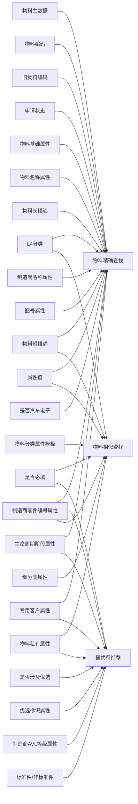

# 语义网络抽取结果

- 节点 135，边 194，平均度 2.87（moderate）
- 节点类型：Entity 8，Field 45，DataTable 8，Dictionary 4，CommonAttribute 14，EnumValue 31，BusinessGroup 3，BusinessRule 19，Scenario 3
- 关系类型：mapsToTable 8，hasKeyField 56，usesDictionary 5，partOf 2，refersTo 9，includesAttribute 14，derivesFrom 3，hasCoreAttribute 3，hasValue 31，preferredFor 3，indicatesBG 1，governedBy 25，supports 33，similarTo 1

## 实体级关系图（虚线 = 推断）

## 枚举值与优选BG

## 应用场景图（谁支持哪个场景；虚线 = 根据字段含义推断，待确认）

## 节点

| 类型 | 节点 | 出度 | 入度 | 出现文档数 |
|---|---|---|---|---|
| BusinessGroup | 国内家电BG | 0 | 1 | 1 |
| BusinessGroup | 汽车电子BG | 0 | 2 | 6 |
| BusinessGroup | 海外家电BG | 0 | 1 | 1 |
| BusinessRule | MPN相近替代判断规则 | 0 | 1 | 2 |
| BusinessRule | 分类代码层级规则 | 0 | 2 | 3 |
| BusinessRule | 分类属性范围匹配规则 | 0 | 2 | 3 |
| BusinessRule | 分类相近标准规则 | 0 | 1 | 2 |
| BusinessRule | 制造商AVL等级筛选规则 | 0 | 1 | 2 |
| BusinessRule | 客户专用料规则 | 0 | 1 | 2 |
| BusinessRule | 属性值解析规则 | 0 | 2 | 3 |
| BusinessRule | 旧物料编码校验规则 | 0 | 1 | 2 |
| BusinessRule | 替代料判断流程 | 0 | 2 | 3 |
| BusinessRule | 有效物料判定规则 | 0 | 1 | 2 |
| BusinessRule | 核心技术属性判定规则 | 0 | 1 | 2 |
| BusinessRule | 汽车电子号段规则 | 0 | 1 | 2 |
| BusinessRule | 物料升级规则 | 0 | 1 | 2 |
| BusinessRule | 物料基础属性取值规则 | 0 | 1 | 2 |
| BusinessRule | 物料描述拼接规则 | 0 | 2 | 3 |
| BusinessRule | 物料查重规则 | 0 | 2 | 3 |
| BusinessRule | 物料状态口径规则 | 0 | 1 | 2 |
| BusinessRule | 物料编码BG前缀规则 | 0 | 1 | 2 |
| BusinessRule | 编码号段选取规则 | 0 | 1 | 2 |
| CommonAttribute | 专用客户属性 | 4 | 1 | 5 |
| CommonAttribute | 优选标识属性 | 4 | 1 | 3 |
| CommonAttribute | 制造商AVL等级属性 | 6 | 1 | 3 |
| CommonAttribute | 制造商名称属性 | 1 | 2 | 4 |
| CommonAttribute | 制造商零件编号属性 | 3 | 2 | 10 |
| CommonAttribute | 品牌异常类型属性 | 0 | 1 | 1 |
| CommonAttribute | 图号属性 | 1 | 1 | 3 |
| CommonAttribute | 文档编号属性 | 0 | 1 | 1 |
| CommonAttribute | 物料名称属性 | 2 | 2 | 4 |
| CommonAttribute | 物料简称属性 | 1 | 1 | 2 |
| CommonAttribute | 物料类型属性 | 1 | 1 | 2 |
| CommonAttribute | 生命周期阶段属性 | 17 | 1 | 5 |
| CommonAttribute | 细分类属性 | 1 | 1 | 2 |
| CommonAttribute | 项目类型属性 | 0 | 1 | 1 |
| DataTable | ac_add_code_apply | 0 | 1 | 1 |
| DataTable | ac_add_code_apply_attr | 0 | 1 | 1 |
| DataTable | ac_add_code_apply_attrp | 0 | 1 | 1 |
| DataTable | ac_attribute_management | 0 | 1 | 1 |
| DataTable | ac_attribute_value | 0 | 1 | 1 |
| DataTable | ac_classification_attribute_ref | 0 | 1 | 1 |
| DataTable | ac_classification_management | 0 | 1 | 1 |
| DataTable | ac_code_range | 0 | 1 | 1 |
| Dictionary | attrType字典 | 0 | 1 | 1 |
| Dictionary | pubOrPri字典 | 0 | 1 | 1 |
| Dictionary | smc字典 | 0 | 1 | 1 |
| Dictionary | yn字典 | 0 | 2 | 1 |
| Entity | 物料主数据 | 24 | 2 | 21 |
| Entity | 物料分类 | 11 | 3 | 8 |
| Entity | 物料分类属性模板 | 19 | 3 | 15 |
| Entity | 物料基础属性 | 33 | 0 | 27 |
| Entity | 物料属性值库 | 10 | 0 | 8 |
| Entity | 物料属性定义 | 3 | 2 | 3 |
| Entity | 物料私有属性 | 11 | 1 | 14 |
| Entity | 物料编码号段 | 12 | 1 | 6 |
| EnumValue | 专用客户-京瓷 | 0 | 1 | 2 |
| EnumValue | 专用客户-兰吉尔 | 0 | 1 | 2 |
| EnumValue | 优选标识-优选1(汽电) | 1 | 1 | 2 |
| EnumValue | 优选标识-优选A | 1 | 1 | 2 |
| EnumValue | 优选标识-优选B | 1 | 1 | 2 |
| EnumValue | 制造商AVL等级-主力 | 0 | 1 | 2 |
| EnumValue | 制造商AVL等级-合格 | 0 | 1 | 2 |
| EnumValue | 制造商AVL等级-考察 | 0 | 1 | 2 |
| EnumValue | 制造商AVL等级-试用 | 0 | 1 | 2 |
| EnumValue | 制造商AVL等级-限制 | 0 | 1 | 2 |
| EnumValue | 生命周期阶段-05 | 0 | 1 | 2 |
| EnumValue | 生命周期阶段-EOL | 0 | 1 | 2 |
| EnumValue | 生命周期阶段-GA | 0 | 1 | 2 |
| EnumValue | 生命周期阶段-NG | 0 | 1 | 2 |
| EnumValue | 生命周期阶段-Preliminary | 0 | 1 | 2 |
| EnumValue | 生命周期阶段-TA | 0 | 1 | 2 |
| EnumValue | 生命周期阶段-YJ | 0 | 1 | 2 |
| EnumValue | 生命周期阶段-完全停产 | 0 | 1 | 2 |
| EnumValue | 生命周期阶段-完全失效 | 0 | 1 | 2 |
| EnumValue | 生命周期阶段-批量 | 0 | 1 | 2 |
| EnumValue | 生命周期阶段-测试 | 0 | 1 | 2 |
| EnumValue | 生命周期阶段-研发 | 0 | 1 | 2 |
| EnumValue | 生命周期阶段-试产 | 0 | 1 | 2 |
| EnumValue | 生命周期阶段-部分失效 | 0 | 1 | 2 |
| EnumValue | 生命周期阶段-采购失效 | 0 | 1 | 2 |
| EnumValue | 申请状态-SCM采购审批中 | 0 | 1 | 2 |
| EnumValue | 申请状态-历史版本 | 0 | 1 | 2 |
| EnumValue | 申请状态-审批完成 | 0 | 1 | 2 |
| EnumValue | 申请状态-标准化审批中 | 0 | 1 | 2 |
| EnumValue | 申请状态-草稿 | 0 | 1 | 2 |
| EnumValue | 申请状态-退回 | 0 | 1 | 2 |
| Field | L1分类 | 0 | 1 | 6 |
| Field | L1分类代码 | 0 | 1 | 3 |
| Field | L2分类 | 0 | 1 | 3 |
| Field | L2分类代码 | 0 | 1 | 2 |
| Field | L3分类 | 0 | 1 | 3 |
| Field | L3分类代码 | 0 | 1 | 2 |
| Field | L4分类 | 2 | 1 | 11 |
| Field | L4分类代码 | 0 | 4 | 9 |
| Field | 元器件物料简称 | 0 | 2 | 3 |
| Field | 公有属性/私有属性 | 1 | 1 | 1 |
| Field | 加码id | 0 | 2 | 5 |
| Field | 单选/多选 | 1 | 0 | 1 |
| Field | 参数值 | 0 | 1 | 1 |
| Field | 唯一性 | 0 | 1 | 1 |
| Field | 属性代码 | 0 | 5 | 11 |
| Field | 属性值 | 2 | 2 | 12 |
| Field | 属性值描述 | 0 | 1 | 1 |
| Field | 属性名称 | 0 | 1 | 2 |
| Field | 属性描述 | 0 | 2 | 2 |
| Field | 属性类型 | 1 | 3 | 4 |
| Field | 当前最大编码 | 0 | 1 | 2 |
| Field | 成组属性 | 0 | 1 | 2 |
| Field | 成组属性拼接符 | 0 | 1 | 2 |
| Field | 旧物料编码 | 1 | 1 | 3 |
| Field | 是否临时码 | 1 | 1 | 1 |
| Field | 是否必填 | 2 | 1 | 5 |
| Field | 是否汽车电子 | 3 | 1 | 4 |
| Field | 是否涉及优选 | 1 | 1 | 2 |
| Field | 是否进ERP物料短描述 | 0 | 1 | 2 |
| Field | 标准件/非标准件 | 1 | 1 | 2 |
| Field | 汽车电子当前最大编码 | 0 | 1 | 2 |
| Field | 汽车电子编码终止 | 0 | 1 | 2 |
| Field | 汽车电子编码起始 | 0 | 1 | 2 |
| Field | 物料子类L4 | 0 | 2 | 3 |
| Field | 物料短描述 | 2 | 1 | 4 |
| Field | 物料短描述顺序 | 0 | 1 | 3 |
| Field | 物料类型 | 0 | 2 | 3 |
| Field | 物料编码 | 1 | 1 | 11 |
| Field | 物料长描述 | 1 | 1 | 3 |
| Field | 申请状态 | 7 | 1 | 6 |
| Field | 编码终止 | 0 | 1 | 2 |
| Field | 编码起始 | 0 | 1 | 2 |
| Field | 英文描述 | 0 | 1 | 2 |
| Field | 项次代码 | 0 | 1 | 1 |
| Field | 默认值 | 0 | 1 | 1 |
| Scenario | 替代料推荐 | 0 | 9 | 10 |
| Scenario | 物料相似查找 | 0 | 8 | 9 |
| Scenario | 物料精确查找 | 0 | 16 | 17 |

## 边

| 起点 | 关系 | 终点 | 关联字段 | 依据 |
|---|---|---|---|---|
| 物料主数据 | mapsToTable | ac_add_code_apply |  | 源码 |
| 物料主数据 | hasKeyField | L1分类 |  | 源码 |
| 物料主数据 | hasKeyField | L2分类 |  | 源码 |
| 物料主数据 | hasKeyField | L3分类 |  | 源码 |
| 物料主数据 | hasKeyField | L4分类 |  | 源码 |
| 物料主数据 | hasKeyField | 物料编码 |  | 源码 |
| 物料主数据 | hasKeyField | 旧物料编码 |  | 源码 |
| 物料主数据 | hasKeyField | 物料短描述 |  | 源码 |
| 物料主数据 | hasKeyField | 物料长描述 |  | 源码 |
| 物料主数据 | hasKeyField | 英文描述 |  | 源码 |
| 物料主数据 | hasKeyField | 申请状态 |  | 源码 |
| 物料主数据 | hasKeyField | 是否临时码 |  | 源码 |
| 物料主数据 | hasKeyField | 是否汽车电子 |  | 源码 |
| 是否汽车电子 | usesDictionary | yn字典 |  | 源码 |
| 是否临时码 | usesDictionary | yn字典 |  | 源码 |
| 物料基础属性 | mapsToTable | ac_add_code_apply_attr |  | 源码 |
| 物料基础属性 | hasKeyField | 加码id |  | 源码 |
| 物料基础属性 | hasKeyField | 属性代码 |  | 源码 |
| 物料基础属性 | hasKeyField | 属性值 |  | 源码 |
| 物料基础属性 | hasKeyField | 属性描述 |  | 源码 |
| 物料基础属性 | hasKeyField | 属性类型 |  | 源码 |
| 物料私有属性 | mapsToTable | ac_add_code_apply_attrp |  | 源码 |
| 物料私有属性 | hasKeyField | 加码id |  | 源码 |
| 物料私有属性 | hasKeyField | 属性代码 |  | 源码 |
| 物料私有属性 | hasKeyField | 属性值 |  | 源码 |
| 物料私有属性 | hasKeyField | 属性描述 |  | 源码 |
| 物料私有属性 | hasKeyField | 属性类型 |  | 源码 |
| 物料分类 | mapsToTable | ac_classification_management |  | 源码 |
| 物料分类 | hasKeyField | L1分类代码 |  | 源码 |
| 物料分类 | hasKeyField | L2分类代码 |  | 源码 |
| 物料分类 | hasKeyField | L3分类代码 |  | 源码 |
| 物料分类 | hasKeyField | L4分类代码 |  | 源码 |
| 物料分类 | hasKeyField | 物料子类L4 |  | 源码 |
| 物料分类 | hasKeyField | 元器件物料简称 |  | 源码 |
| 物料分类 | hasKeyField | 是否涉及优选 |  | 源码 |
| 物料分类 | hasKeyField | 标准件/非标准件 |  | 源码 |
| 物料属性定义 | mapsToTable | ac_attribute_management |  | 源码 |
| 物料属性定义 | hasKeyField | 属性代码 |  | 源码 |
| 物料属性定义 | hasKeyField | 属性名称 |  | 源码 |
| 物料分类属性模板 | mapsToTable | ac_classification_attribute_ref |  | 源码 |
| 物料分类属性模板 | hasKeyField | L4分类代码 |  | 源码 |
| 物料分类属性模板 | hasKeyField | 属性代码 |  | 源码 |
| 物料分类属性模板 | hasKeyField | 公有属性/私有属性 |  | 源码 |
| 物料分类属性模板 | hasKeyField | 属性类型 |  | 源码 |
| 物料分类属性模板 | hasKeyField | 唯一性 |  | 源码 |
| 物料分类属性模板 | hasKeyField | 物料短描述顺序 |  | 源码 |
| 物料分类属性模板 | hasKeyField | 是否进ERP物料短描述 |  | 源码 |
| 物料分类属性模板 | hasKeyField | 成组属性 |  | 源码 |
| 物料分类属性模板 | hasKeyField | 成组属性拼接符 |  | 源码 |
| 物料分类属性模板 | hasKeyField | 是否必填 |  | 源码 |
| 物料分类属性模板 | hasKeyField | 默认值 |  | 源码 |
| 公有属性/私有属性 | usesDictionary | pubOrPri字典 |  | 源码 |
| 属性类型 | usesDictionary | attrType字典 |  | 源码 |
| 单选/多选 | usesDictionary | smc字典 |  | 源码 |
| 物料属性值库 | mapsToTable | ac_attribute_value |  | 源码 |
| 物料属性值库 | hasKeyField | L4分类代码 |  | 源码 |
| 物料属性值库 | hasKeyField | 属性代码 |  | 源码 |
| 物料属性值库 | hasKeyField | 项次代码 |  | 源码 |
| 物料属性值库 | hasKeyField | 参数值 |  | 源码 |
| 物料属性值库 | hasKeyField | 属性值描述 |  | 源码 |
| 物料编码号段 | mapsToTable | ac_code_range |  | 源码 |
| 物料编码号段 | hasKeyField | L4分类代码 |  | 源码 |
| 物料编码号段 | hasKeyField | 编码起始 |  | 源码 |
| 物料编码号段 | hasKeyField | 编码终止 |  | 源码 |
| 物料编码号段 | hasKeyField | 当前最大编码 |  | 源码 |
| 物料编码号段 | hasKeyField | 汽车电子编码起始 |  | 源码 |
| 物料编码号段 | hasKeyField | 汽车电子编码终止 |  | 源码 |
| 物料编码号段 | hasKeyField | 汽车电子当前最大编码 |  | 源码 |
| 物料编码号段 | hasKeyField | 物料类型 |  | 源码 |
| 物料基础属性 | partOf | 物料主数据 | 加码id | 源码 |
| 物料私有属性 | partOf | 物料主数据 | 加码id | 源码 |
| 物料主数据 | refersTo | 物料分类 | L1分类、L2分类、L3分类、L4分类 | 源码 |
| 物料主数据 | refersTo | 物料编码号段 | L4分类 | 源码 |
| 物料分类属性模板 | refersTo | 物料分类 | L4分类代码 | 源码 |
| 物料分类属性模板 | refersTo | 物料属性定义 | 属性代码 | 业务方确认 |
| 物料属性值库 | refersTo | 物料分类属性模板 | L4分类代码、属性代码 | 源码 |
| 物料属性值库 | refersTo | 物料属性定义 | 属性代码 | 源码 |
| 物料编码号段 | refersTo | 物料分类 | L4分类代码 | 源码 |
| 物料基础属性 | refersTo | 物料分类属性模板 | 属性代码 | 源码 |
| 物料私有属性 | refersTo | 物料分类属性模板 | 属性代码 | 源码 |
| 物料基础属性 | includesAttribute | 物料名称属性 |  | 业务方确认 |
| 物料名称属性 | derivesFrom | 物料子类L4 |  | 业务方确认 |
| 物料基础属性 | includesAttribute | 物料简称属性 |  | 源码 |
| 物料简称属性 | derivesFrom | 元器件物料简称 |  | 源码 |
| 物料基础属性 | includesAttribute | 物料类型属性 |  | 源码 |
| 物料类型属性 | derivesFrom | 物料类型 |  | 源码 |
| 物料基础属性 | includesAttribute | 生命周期阶段属性 |  | 业务方确认 |
| 物料基础属性 | includesAttribute | 优选标识属性 |  | 业务方确认 |
| 物料基础属性 | includesAttribute | 制造商AVL等级属性 |  | 业务方确认 |
| 物料基础属性 | includesAttribute | 专用客户属性 |  | 业务方确认 |
| 物料基础属性 | includesAttribute | 制造商零件编号属性 |  | 业务方确认 |
| 物料基础属性 | includesAttribute | 制造商名称属性 |  | 业务方确认 |
| 物料基础属性 | includesAttribute | 图号属性 |  | 源码 |
| 物料基础属性 | includesAttribute | 项目类型属性 |  | 源码 |
| 物料基础属性 | includesAttribute | 品牌异常类型属性 |  | 源码 |
| 物料基础属性 | includesAttribute | 细分类属性 |  | 源码 |
| 物料基础属性 | includesAttribute | 文档编号属性 |  | 源码 |
| 物料基础属性 | hasCoreAttribute | 物料名称属性 |  | 业务方确认 |
| 物料基础属性 | hasCoreAttribute | 制造商零件编号属性 |  | 业务方确认 |
| 物料基础属性 | hasCoreAttribute | 制造商名称属性 |  | 业务方确认 |
| 申请状态 | hasValue | 申请状态-草稿 |  | 业务方确认 |
| 申请状态 | hasValue | 申请状态-标准化审批中 |  | 业务方确认 |
| 申请状态 | hasValue | 申请状态-审批完成 |  | 业务方确认 |
| 申请状态 | hasValue | 申请状态-SCM采购审批中 |  | 业务方确认 |
| 申请状态 | hasValue | 申请状态-退回 |  | 业务方确认 |
| 申请状态 | hasValue | 申请状态-历史版本 |  | 业务方确认 |
| 生命周期阶段属性 | hasValue | 生命周期阶段-研发 |  | 业务方确认 |
| 生命周期阶段属性 | hasValue | 生命周期阶段-测试 |  | 业务方确认 |
| 生命周期阶段属性 | hasValue | 生命周期阶段-试产 |  | 业务方确认 |
| 生命周期阶段属性 | hasValue | 生命周期阶段-批量 |  | 业务方确认 |
| 生命周期阶段属性 | hasValue | 生命周期阶段-EOL |  | 业务方确认 |
| 生命周期阶段属性 | hasValue | 生命周期阶段-部分失效 |  | 业务方确认 |
| 生命周期阶段属性 | hasValue | 生命周期阶段-采购失效 |  | 业务方确认 |
| 生命周期阶段属性 | hasValue | 生命周期阶段-完全失效 |  | 业务方确认 |
| 生命周期阶段属性 | hasValue | 生命周期阶段-完全停产 |  | 业务方确认 |
| 生命周期阶段属性 | hasValue | 生命周期阶段-TA |  | 业务方确认 |
| 生命周期阶段属性 | hasValue | 生命周期阶段-GA |  | 业务方确认 |
| 生命周期阶段属性 | hasValue | 生命周期阶段-NG |  | 业务方确认 |
| 生命周期阶段属性 | hasValue | 生命周期阶段-05 |  | 业务方确认 |
| 生命周期阶段属性 | hasValue | 生命周期阶段-YJ |  | 业务方确认 |
| 生命周期阶段属性 | hasValue | 生命周期阶段-Preliminary |  | 业务方确认 |
| 优选标识属性 | hasValue | 优选标识-优选A |  | 业务方确认 |
| 优选标识属性 | hasValue | 优选标识-优选B |  | 业务方确认 |
| 优选标识属性 | hasValue | 优选标识-优选1(汽电) |  | 业务方确认 |
| 优选标识-优选A | preferredFor | 海外家电BG |  | 业务方确认 |
| 优选标识-优选B | preferredFor | 国内家电BG |  | 业务方确认 |
| 优选标识-优选1(汽电) | preferredFor | 汽车电子BG |  | 业务方确认 |
| 专用客户属性 | hasValue | 专用客户-兰吉尔 |  | 业务方确认 |
| 专用客户属性 | hasValue | 专用客户-京瓷 |  | 业务方确认 |
| 制造商AVL等级属性 | hasValue | 制造商AVL等级-主力 |  | 业务方确认 |
| 制造商AVL等级属性 | hasValue | 制造商AVL等级-合格 |  | 业务方确认 |
| 制造商AVL等级属性 | hasValue | 制造商AVL等级-试用 |  | 业务方确认 |
| 制造商AVL等级属性 | hasValue | 制造商AVL等级-考察 |  | 业务方确认 |
| 制造商AVL等级属性 | hasValue | 制造商AVL等级-限制 |  | 业务方确认 |
| 是否汽车电子 | indicatesBG | 汽车电子BG |  | 业务方确认 |
| 物料主数据 | governedBy | 有效物料判定规则 |  | 业务方确认 |
| 物料主数据 | governedBy | 物料升级规则 |  | 业务方确认 |
| 物料主数据 | governedBy | 物料状态口径规则 |  | 业务方确认 |
| 物料主数据 | governedBy | 物料编码BG前缀规则 |  | 业务方确认 |
| 物料主数据 | governedBy | 物料描述拼接规则 |  | 源码 |
| 物料主数据 | governedBy | 旧物料编码校验规则 |  | 源码 |
| 物料主数据 | governedBy | 物料查重规则 |  | 源码 |
| 物料主数据 | governedBy | 分类代码层级规则 |  | 源码 |
| 物料基础属性 | governedBy | 物料基础属性取值规则 |  | 源码 |
| 物料基础属性 | governedBy | 客户专用料规则 |  | 业务方确认 |
| 物料基础属性 | governedBy | 物料查重规则 |  | 源码 |
| 物料基础属性 | governedBy | 制造商AVL等级筛选规则 |  | 业务方确认 |
| 物料基础属性 | governedBy | MPN相近替代判断规则 |  | 业务方确认 |
| 物料基础属性 | governedBy | 替代料判断流程 |  | 业务方确认 |
| 物料私有属性 | governedBy | 替代料判断流程 |  | 业务方确认 |
| 物料分类 | governedBy | 分类代码层级规则 |  | 源码 |
| 物料分类 | governedBy | 分类相近标准规则 |  | 业务方确认 |
| 物料分类属性模板 | governedBy | 分类属性范围匹配规则 |  | 源码 |
| 物料分类属性模板 | governedBy | 属性值解析规则 |  | 源码 |
| 物料分类属性模板 | governedBy | 物料描述拼接规则 |  | 源码 |
| 物料分类属性模板 | governedBy | 核心技术属性判定规则 |  | 业务方确认 |
| 物料属性值库 | governedBy | 分类属性范围匹配规则 |  | 源码 |
| 物料属性值库 | governedBy | 属性值解析规则 |  | 源码 |
| 物料编码号段 | governedBy | 编码号段选取规则 |  | 源码 |
| 物料编码号段 | governedBy | 汽车电子号段规则 |  | 源码 |
| 物料主数据 | supports | 物料精确查找 |  | 源码 |
| 物料编码 | supports | 物料精确查找 |  | 业务方确认 |
| 旧物料编码 | supports | 物料精确查找 |  | 源码 |
| 申请状态 | supports | 物料精确查找 |  | 业务方确认 |
| L4分类 | supports | 物料精确查找 |  | 源码 |
| 物料基础属性 | supports | 物料精确查找 |  | 源码 |
| 物料名称属性 | supports | 物料精确查找 |  | 源码 |
| 物料短描述 | supports | 物料精确查找 |  | 业务方确认 |
| 物料长描述 | supports | 物料精确查找 |  | 业务方确认 |
| 属性值 | supports | 物料精确查找 |  | 业务方确认 |
| 制造商名称属性 | supports | 物料精确查找 |  | 业务方确认 |
| 制造商零件编号属性 | supports | 物料精确查找 |  | 业务方确认 |
| 图号属性 | supports | 物料精确查找 |  | 源码 |
| 生命周期阶段属性 | supports | 物料精确查找 |  | 业务方确认 |
| 专用客户属性 | supports | 物料精确查找 |  | 业务方确认 |
| 是否汽车电子 | supports | 物料精确查找 |  | 业务方确认 |
| L4分类 | supports | 物料相似查找 |  | 业务方确认 |
| 物料分类属性模板 | supports | 物料相似查找 |  | 业务方确认 |
| 是否必填 | supports | 物料相似查找 |  | 业务方确认 |
| 是否必填 | supports | 替代料推荐 |  | 业务方确认 |
| 属性值 | supports | 物料相似查找 |  | 业务方确认 |
| 物料短描述 | supports | 物料相似查找 |  | 业务方确认 |
| 物料私有属性 | supports | 物料相似查找 |  | 业务方确认 |
| 细分类属性 | supports | 物料相似查找 |  | 业务方确认 |
| 物料私有属性 | supports | 替代料推荐 |  | 业务方确认 |
| 是否涉及优选 | supports | 替代料推荐 |  | 业务方确认 |
| 优选标识属性 | supports | 替代料推荐 |  | 业务方确认 |
| 制造商AVL等级属性 | supports | 替代料推荐 |  | 业务方确认 |
| 标准件/非标准件 | supports | 替代料推荐 |  | 业务方确认 |
| 制造商零件编号属性 | supports | 替代料推荐 |  | 业务方确认 |
| 制造商零件编号属性 | supports | 物料相似查找 |  | 业务方确认 |
| 生命周期阶段属性 | supports | 替代料推荐 |  | 业务方确认 |
| 专用客户属性 | supports | 替代料推荐 |  | 业务方确认 |
| 物料基础属性 | similarTo | 物料私有属性 | 加码id、属性代码、属性值、属性描述、属性类型 | 语义分析推断 |
